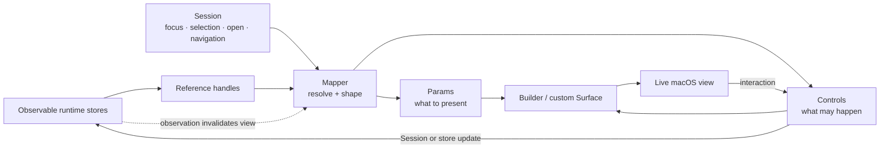

# Scint

Scint is the application and presentation framework that gives the runtime a native,
navigable form. The runtime owns contexts, references, topology, capabilities,
transcripts, and execution. Scint turns those values into a macOS workspace where they
can be found, inspected, edited, arranged, and run.

That boundary is important. Scint does not rebuild runtime objects as application
models, and its views do not become another source of truth. The framework carries
`Reference` values through session state, resolves them when a surface is evaluated,
maps the resulting domain values into short-lived presentation parameters, and bridges
interaction back through reference-aware controls.

> A live view of runtime data is a recurring query plus a set of permitted mutations,
> not a second domain model.

This gives Scint and ScintRuntime complementary jobs:

| Layer | Composition |
| --- | --- |
| ScintRuntime | Maps an authored `Workspace` or `Space` and its live `Context` into a `Composition` |
| Scint framework | Maps runtime references and application session state into `Params`, `Controls`, and native views |

The runtime brings a context into a running tense. Scint makes that process legible and
operable without separating it from the environment that produced it.

## The live-view loop

The framework revolves around a small presentation pipeline:



The loop has no long-lived copy of a `Space`, `Material`, `Harness`, or `Transcript`.
Runtime stores retain the values; the application retains references. When observable
runtime or session state changes, SwiftUI evaluates the surface again, its mapper
resolves the references again, and the next parameter tree describes the next view.

This is a projection in the ordinary UI sense, but it is not a materialized application
model. `Params` exist for a render pass. Identity and mutation still lead back to the
runtime.

## Reference is the application's currency

A runtime `Reference` is both an address and a join point. From the same handle, Scint
can:

- resolve the concrete value through `Workspace.with`, `Space.with`, `Material.with`, or
  another typed accessor;
- read its `Descriptor` for a name, description, tags, framing, and iconography;
- determine whether it is structural, malleable, or functional;
- hold it in selection, focus, navigation, or the set of open documents;
- move or share it through drag and drop without serializing the complete value; and
- ask the runtime for the live `Composition` associated with its context.

The framework therefore does not need a `SpaceViewModel`, `MaterialViewModel`, and
`HarnessViewModel` that can drift away from their stores. A mapper can resolve the
current value and retain the same reference as presentation identity:

```swift
let items = Workspace.with(model.session.workspace) { workspace in
    workspace.spaces.map { ref in
        ItemParams(
            ref: ref,
            name: ref.descriptor.name,
            image: Iconography.symbol(for: ref)
        )
    }
} ?? []
```

The matching control travels in the other direction:

```swift
let controls = Controls(
    onSelect: { item in
        guard let ref = item.ref else { return }
        model.select(ref)
    }
)
```

`ItemParams` supplies enough information to render and identify the row. The closure
uses the reference to change session or runtime state. Neither becomes the owner of the
domain value.

## Panelwork roles

The framework types divide query, presentation, interaction, and view state rather than
mixing all four into a single SwiftUI hierarchy:

| Type | Responsibility |
| --- | --- |
| `Model` | Supplies the shared `Session` and `FileProvider`, plus common focus, selection, open, search, compose, and start operations |
| `Session` | Holds application state as references: focus, selection axes, open materials and transcripts, and navigation history |
| `Mapper` | Resolves current runtime and session state into `Params` and `Controls` |
| `Params` | Describes what a surface should present during this evaluation |
| `Controls` | Describes the interactions, mutations, wrappers, and permissions available to that surface |
| `Panel` | Owns local presentation state and chooses the mapper and surface for one region of the app |
| `Surface` | Hosts a panel and model, either through the shared builder or a specialized view |
| `Builder` | Renders common parameter trees into consistent grid, group, list, or table layouts |

This separation keeps runtime knowledge near the mapper and reusable view behavior near
the builder. A sidebar does not need to know how a space is stored. A mapper does not
need to implement list disclosure, a context menu, or drop handling. A button does not
need to know whether its mutation targets a workspace, space, or session; the control
closure already carries that decision.

### Model and Session

`StudioModel` and `PanelsModel` conform to `Model`. Each provides a `Session` and a
`FileProvider`, while the protocol extension supplies the common application verbs:

- focus or select a reference;
- open malleable content;
- load a workspace;
- compose or start an origin; and
- search the runtime catalog.

`Session` owns UI truth, not runtime truth. Its selection has independent axes for a
structure, functional interface, malleable content, entry identifier, and URL. It also
tracks typed focus, open material and transcript references, and a bounded back/forward
history of selections.

Keeping these as references matters. A material can remain open while its blocks change; a
space can stay selected while its closure changes; a transcript can remain visible as
signals arrive. Session state identifies *which* value the user means, while the mapper
asks the runtime what that value contains now.

### Mapper

A `Mapper` is a domain query, not a view model. Its two static functions answer separate
questions:

- `parameters(_:)`: what should be visible right now?
- `controls(_:)`: what may the user do with it?

Studio mappers resolve workspace topology, open documents, library contents,
transcripts, harness configuration, and material blocks. Palette mappers issue catalog
searches and regroup the results as content, interfaces, or structures. Because mapper
evaluation happens inside a SwiftUI surface, reads from observable stores and session
objects participate in view invalidation.

### Params

Presentation parameters form a shallow tree:

```text
Params
├── HostParams        floating size, input, modes, selection
└── ComponentParams[]  named sections
    └── ItemParams[]   references, entries, paths, labels, values, children
```

`ItemParams` can identify a runtime value by reference, a material or transcript entry by
UUID, a filesystem child by URL, or a synthetic control by key. It carries labels,
icons, counts, values, trailing-control kinds, and recursive children, but remains an
immutable description of one evaluation.

At the surface level, `Params` selects one of four common layouts—grid, group, list, or
table—and one of three nesting policies: flat, single-level, or recursive. Mappers can
therefore describe a hierarchical space browser, a grouped inspector, and a flat
library without owning three independent rendering systems.

### Controls

`Controls` is the behavioral half of the mapping. It carries callbacks for selection,
opening, toggling, changing values, running actions, adding, renaming, deleting,
duplicating, moving, dragging, and dropping. It can also provide context-menu items,
row wrappers, accessories, and predicates that decide which edits are allowed.

The presence of a closure is itself capability information. If a mapper supplies no
rename callback, the builder does not present rename behavior. If a reference cannot be
moved without creating a topology cycle, `ReferenceTransfer` rejects the drop. The view
does not infer authority from its appearance.

### Panel, Surface, and Builder

A `Panel` owns presentation-only state in `PanelState`: visibility, split position,
filter and query text, expanded identifiers, and small keyed values. It then chooses
the active mapper and surface. For example, `StudioSidebar` switches among workspace,
transcript, and library mappings without changing the shell that hosts them.

`AnySurface` is the generic path. It asks its panel for parameters and controls, then
passes both to `Builder`. The builder:

- renders component and item trees in the selected layout;
- applies flat, single, or recursive disclosure behavior;
- supplies standard icons and trailing controls;
- attaches selection and open callbacks;
- installs context menus, wrappers, and accessories; and
- applies shared reference drag-and-drop behavior.

This is where interaction conventions become consistent across otherwise unrelated
runtime types.

Specialized surfaces remain available where the shared grammar is not expressive
enough:

| Surface | Specialized responsibility |
| --- | --- |
| `EditorSurface` | Hosts the block editor for the active `Material` reference |
| `ComposerSurface` | Resolves an active `Transcript` and renders its inputs, messages, reasoning, tool calls, and failures |
| `SearchSurface` | Adds keyboard navigation, query input, result selection, and search-mode switching |
| Space and workspace canvases | Reuse mapped params and controls inside the split Studio canvas |

They still conform to `Surface`, retain the panel/model boundary, and use references as
their domain identity.

## From session state to runtime context

The application session is not only navigation state. At execution time, Scint makes
the relevant part of it explicit context.

`Session.rendered` encodes the current focus, selection, and open material/transcript
references as a runtime `Value`. When `Model.start(_:)` is called, the framework:

1. resolves the selected workspace or space's current input material;
2. requires authored input to be present;
3. appends the rendered session value to that input;
4. calls `Runtime.shared.start(origin)`;
5. receives the live `Composition`; and
6. opens its current intent transcript in the session.

The runtime then attaches the input material to the new intent transcript and rotates the
origin to a fresh input material. The visible application state has crossed the boundary
as data, while the resulting transcript returns as another reference the application
already knows how to present.

That creates a complete loop:

```text
user-authored Material + rendered Session
                    ↓
             Runtime Context / Intent
                    ↓
             Transcript references
                    ↓
          Mapper or ComposerSurface
                    ↓
                live view
```

`Composition` participates in the same way. The context toolbar resolves it from the
selected structural reference and reads its computed state. Scint does not mirror
running state into a separate application process model.

## The Studio assembled from mappings

`ScintModel` boots the runtime, loads sample data when needed, starts the local server,
and coordinates Studio, palette, and floating panels. `StudioModel` supplies the
session shared by the principal application regions:

| Region | What it maps |
| --- | --- |
| Sidebar | Nested spaces, filesystem locations, open materials, transcripts, and library interfaces |
| Material | Workspace or space contents, the active material editor, and the active transcript composer |
| Inspector | Harnesses, commands, configuration, files, and material structure for the focused reference |
| Palette | Ranked catalog search across content, interfaces, and workspace topology |

The main window is a native `NavigationSplitView` with a SwiftUI inspector and a
customizable split canvas. A borderless AppKit `NSPanel` hosts the global palette so it
can float across spaces and applications, become key for keyboard input, and dismiss on
Escape. AppKit bridges also handle split views, pasteboard transfer, and editor behavior
where desktop interaction needs tighter control than stock SwiftUI supplies.

The framework's visual vocabulary—icons, tints, layouts, menus, fields, tabs, toolbars,
and badges—is centralized under `Panelwork`. Domain code supplies meaning through
references; the design system supplies a consistent native expression.

## System boundaries

All major layers now live in this repository, but they retain narrow responsibilities:

| Source area | Boundary |
| --- | --- |
| `Sources/Scint` | Application session, mapping framework, native views, panels, editor, and palette |
| `Sources/ScintRuntime` | Domain identity, stores, topology, persistence, context composition, and transcripts |
| `Sources/ScintServer` | Loopback MCP projection of a currently active runtime context |
| `Sources/ScintService` | `scintd` XPC process launch, streaming I/O, termination, and restart behavior |

The server follows the same reference-first rule as the UI. An MCP request supplies a
`SCINT_CONTEXT` bearer identifier, the server resolves a live composition, and its tools
and resources are derived from the origin's current closure. It does not maintain a
second capability catalog. The service remains below both UI and protocol concerns and
only supervises processes.

For the runtime process model itself, see [ScintRuntime](ScintRuntime.md).

## Repository layout

```text
Sources/Scint/
├── Scint.swift                 App entry point and materials
├── ScintModel.swift            Runtime boot and top-level coordination
├── ScintMenu.swift             Menu-bar status surface
├── Core/
│   ├── Model/                  Session, selection, navigation
│   └── Providers/              Files, panels, actions, shortcuts, transfer
├── Panelwork/
│   ├── Builder.swift           Shared parameter-tree renderer
│   ├── Params.swift            Presentation descriptions
│   ├── Controls.swift          Interaction capabilities
│   ├── Types.swift             Model, Mapper, Panel, Surface contracts
│   ├── Layouts/                Grid, group, list, and table layouts
│   ├── Tokens/                 Design, iconography, and styles
│   ├── Utilities/              AppKit bridges and shared helpers
│   └── Views/                  Reusable controls and chrome
└── Features/
    ├── Studio/                 Main workspace, panels, and mappers
    ├── Palette/                Search model, mappings, and panels
    ├── Editor/                 Block-based Material editor
    └── Surfaces/               Composer, editor, and search surfaces
```

## Current edges

Scint is an active systems prototype. The reference-driven view path is in use across
the sidebar, canvases, inspector, library, transcript browser, and palette. Material
editing, runtime search, context configuration, composition, transcript rendering,
reference transfer, persistence, MCP projection, and XPC execution all have implemented
paths.

Some affordances are still skeletal. Several general action-provider entry points,
context toolbar buttons, deletion behavior, and the console panel remain placeholders.
Observation and traversal behavior are also incomplete in the runtime. The project has
no dedicated application test target, and its stores assume coordinated app-level
access rather than arbitrary concurrent mutation.

The app and service currently run without App Sandbox or Hardened Runtime. Executable
artifacts and harnesses run with the user's authority; workspaces and imported
capabilities should therefore be treated as trusted input.
