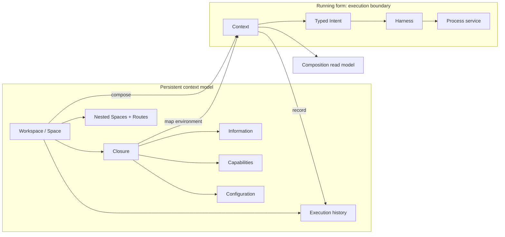

# ScintRuntime

Scint Runtime is the Swift context model and composition engine behind **Scint
Studio**, a native macOS environment for composing and running agentic systems.

Most agent software treats context as an input assembled immediately before a request:
a prompt, a chat log, or a bag of retrieved data. Scint Runtime treats context as a
first-class systems model. Information, capabilities, configuration, relationships,
and execution history belong to a persistent, scoped environment that can be authored,
run, inspected, changed, and resumed.

That is the central idea of the project:

> Context is not merely input to a process. It is the environment in which the process
> exists.

## The model of context

A context has persistent, authored structure and a temporary running form. The types in
the runtime describe different dimensions of the same model rather than independent
subsystems:

| Dimension | Runtime model |
| --- | --- |
| Authored origin | A `Workspace` or `Space` locates agent work within the persistent topology |
| Environment | Its `Closure` contains input, information, capabilities, and configuration |
| Relationships | Nested spaces and `Route`s connect local contexts into a larger topology |
| Content | `Sheet`s provide authorable information; `Artifact`s point to external resources |
| Capability | `Command`s and `Harness`es describe what the context can do |
| Running form | A `Context` composes the boundary into typed intentions and executes them |
| Continuity | Execution history records inputs, activity, output, completion, and provider state |
| Application view | `Composition` projects the live context into state Scint Studio can present |

Together, these form the process. Scint Runtime does not need a separate process object
beside the context: a context is the execution boundary, and composing it is what gives
that boundary a running tense.



### Authored context

`Workspace` is the persistent root. A workspace owns root `Space`s, and spaces can nest
to form smaller contextual worlds. Every workspace and space owns a `Closure` containing:

- an input sheet;
- ordered content, including sheets and prior execution history;
- a set of resource and capability interfaces; and
- ordered configuration values.

Containment expresses ownership and isolation. `Route`s express connectivity without
changing ownership. The runtime can therefore derive context by walking down nested
spaces, climbing toward a parent, or crossing routes to adjacent spaces. Scope is not a
global bag or a field on an object; it is a reachable portion of this authored topology.

### Running context

Composing a workspace or space creates one live `Context` for that origin. The context
resolves the origin's closure and active harness, maps the environment into typed
values, selects an intent, executes it, and records what happens.

Five intent modes describe how work can proceed:

- `compose` delegates into another composed operation;
- `dispatch` invokes commands;
- `observe` reacts to changes inside reachable context;
- `execute` runs a harness and streams its output; and
- `traverse` carries an objective across the route graph.

`Composer` is the sole owner of live contexts. `Composition` is the application-facing
read model: it holds the origin and resolves the current context when read, deriving
state instead of copying runtime data into UI-owned state.

Execution history is part of the context's continuity. Internally, a root transcript
records the context lifecycle while branches record individual intentions. That shape
preserves inputs, provider state, activity, and terminal outcomes so work can be
inspected or resumed. The nesting is an implementation of continuity, not a separate
concept beside context.

## Architectural synthesis

Scint Runtime draws from ECS and actor systems, but it is not an implementation of
either model and should not be understood by where it superficially resembles them.
Their influence is visible in the decisions the runtime takes further.

From ECS, the runtime takes the separation of identity from state and the organization
of state into stores partitioned by concrete type. Its storage plane is deliberately
ECS-shaped: values of each type live together, and protocols route them through the
appropriate family of stores.

From actor systems, it takes the importance of durable identity and reference-mediated
interaction. Callers pass stable `Reference` values instead of carrying mutable domain
objects through the system.

Scint Runtime then changes both ideas to serve a different goal. A `Reference` does not
address an actor or mailbox; it resolves through shared typed stores, metadata, and
persistence. A `Space` is not an entity assembled from an arbitrary bag of components;
it is an authored contextual world with ownership, capabilities, topology, and a
running form. The result is a reference-addressed context fabric in which data can be
shared without collapsing scope and processes can remain connected to the environments
that produced them.

## Reference-addressed storage

Every stored domain value carries a `Reference` with independent addressing facets:

| Facet | Responsibility |
| --- | --- |
| `id` | Identifies the runtime instance |
| `typeId` | Selects its concrete type and store using deterministic type identity |
| `descriptorId` | Locates its metadata in the `Catalog` |
| `contextId` | Participates in contextual keys when an origin is composed |
| `storageId` | Addresses its PersistedObject record |

`contextId` alone does not define contextual scope. Effective scope comes from the
origin's closure, containment hierarchy, and reachable routes.

Protocol families provide the top-level routing:

| Family | Role | Concrete types | Storage |
| --- | --- | --- | --- |
| `Structural` | Context boundaries and topology | `Workspace`, `Space`, `Closure`, `Route` | `Workspaces` |
| `Malleable` | Authorable content and history | `Sheet`, `Transcript` | `Library` content stores |
| `Functional` | Resources and executable capabilities | `Artifact`, `Command`, `Harness` | `Library` interface stores |
| `Contextual` | Live execution state | `Context` and typed intents | `Composer` |

The `Catalog` is a separate metadata plane. Every stored reference has a `Descriptor`
containing its name, description, tags, framing, publication state, and timestamps.
Separating metadata from values allows the runtime to search and describe its world
without loading every object.

Callers retain references, not snapshots of stored values:

```swift
let brief = Sheet.new(space, name: "Research Brief")

Sheet.update(brief) { sheet in
    sheet.insert(.text(UUID(), "Compare the primary sources."), at: nil)
}

let prompt = Sheet.with(brief) { $0.rendered }
```

`with` scopes a read to the store. `update` writes the mutation back and schedules
persistence. Both return optionals, so a reference routed to the wrong store or concrete
type returns `nil`.

## Information and capabilities

`Sheet` is a block document that can combine text, tasks, resources, commands, and other
sheets. Rendering a closure turns its sheets into the information supplied to a run.

Executable capabilities form a compositional ladder:

1. `Artifact` classifies and addresses a file, directory, executable, application,
   script, skill, image, or external URL.
2. `Command` combines an executable artifact with fixed and caller-bound parameters.
3. `Harness` gives a command contextual parameters and an intent.

The recursive `Value` type serves as both runtime data and parameter schema. It validates
primitive values, collections, sequences, and references before rendering an invocation.
`Property` and `Properties` provide a separate JSON algebra for arbitrary external
payloads and polymorphic persistence.

This keeps the capability model provider-neutral. Local executables, command-line
agents, HTTP services, filesystem operations, and scheduled observers all enter the
model through the same resource, command, and harness abstractions.

## Execution, observation, and persistence

`Runtime.shared.trigger(origin)` starts the running form of a context:

1. `Composer` creates or reuses the live `Context` for the origin.
2. The context resolves its closure, capabilities, configuration, and prior history.
3. `Parser` binds that environment to the active harness.
4. The selected intent executes through `Harness → Command → Artifact → Services`.
5. The XPC client sends the executable, arguments, and environment to
   `com.kaechle.Scintd`.
6. Streamed output becomes lifecycle signals and preserved provider data.
7. The context records the result and `Composition` derives the new application state.

The service bridge buffers output until a PID handler is installed and carries partial
lines across chunks, protecting the handoff between synchronous process control and
asynchronous output.

Persistence follows ownership:

- the structural context graph is saved atomically in the active workspace file;
- library content and interfaces are stored as independent JSON records under the
  XDG data directory;
- descriptors and values are validated against the same reference facets during
  encoding and decoding; and
- `Coordinator` debounces mutations, batches writes, retries failures, and forwards
  changes to live observing contexts.

Catalog-backed search ranks names, descriptions, tags, and types, with `!`-prefixed tag
or type facets. The `Scint://` callback surface exposes open, trigger, dispatch, run,
and search actions by descriptor identity, allowing external schedulers and macOS
integrations to re-enter the same context model.

## Public surface

```swift
import Scint Runtime
import Foundation

try await Runtime.shared.load()

let space = Space.new("Research", owner: Runtime.shared.workspace)
let brief = Sheet.new(space, name: "Brief")

Sheet.update(brief) {
    $0.insert(.text(UUID(), "Find the strongest primary evidence."), at: nil)
}

let reachable = Runtime.shared.context(from: space)
let results = Runtime.shared.search("research !component")

try await Runtime.shared.save()
```

The facade also exposes containment and route traversal through `walk`, `climb`,
`adjacent`, and `cross`, plus live compositions through `context(for:)`.

## Repository layout

```text
Sources/Scint Runtime/
├── Core/
│   ├── Typing/       References, protocols, type registry
│   ├── Data/         Typed stores, persistence, settings, coordination
│   └── Records/      Values, properties, signals, search, errors
├── Environment/
│   ├── Structures/  Workspace, Space, Closure, Route
│   ├── Content/     Sheet, Transcript
│   ├── Interfaces/  Artifact, Command, Harness
│   └── Processes/   Context, intents, parsing, context mapping
├── Services/         XPC client and sample context definitions
└── Runtime.swift     Public facade, callbacks, search, traversal
```

The Swift Testing suite exercises reference and catalog invariants, recursive value
construction, parameter rendering, context composition, execution continuity,
persistence paths, callbacks, and reciprocal space relationships.

## Status and trade-offs

Scint Runtime targets **Swift 6.2** and **macOS 26**. It is a library rather than a
standalone executable. Running executable harnesses requires the companion
`com.kaechle.Scintd` service, which is not included in this package. Route traversal is
modeled, while the `Traversing` intent currently completes as a stub.

Reference-addressed storage makes sharing, cycles, and uniform metadata possible, but
some ownership and type invariants are enforced at runtime through optionals and
preconditions. Execution continuity depends on runners emitting terminal signals.
Stores are observable and currently use `@unchecked Sendable`; the architecture assumes
coordinated app-level access rather than arbitrary concurrent mutation.

Build the library and run its tests with:

```sh
swift build
swift test
```
