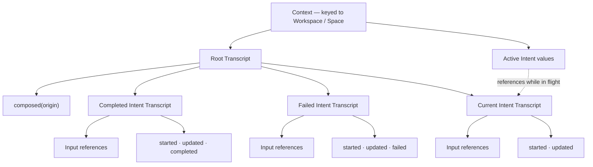
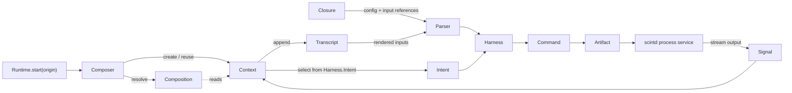

# ScintRuntime

Scint Runtime is the context model and composition engine at the heart of Scint.
Studio authors its structures, the process service executes its capabilities, and the
rest of the application reads the compositions it produces.

Most agent runtimes assemble context at the last possible moment: a prompt, a chat log,
or a bag of retrieved data built immediately before a request. Scint starts from the
opposite premise. Context is the authored environment in which work exists. It has an
identity, a topology, information, capabilities, configuration, and a history before it
ever has a process identifier.

> Context is not merely input to a process. It is the environment in which the process
> exists.

The runtime's central move is to bring that environment into a running tense without
inventing a second model that owns the truth. A `Workspace` or `Space` is an authored
place. An active `Harness` makes that place composable. `Composer` associates it with a
live `Context`; the context evaluates work as typed `Intent`s; signals leave a record in
`Transcript`s; and `Composition` maps the whole relationship into something the rest of
Scint can read.

There is no separate process object hiding beside the context. The context is the
process boundary, and composition is how that boundary becomes runnable.

## The runtime process

The process system is deliberately small. Each type describes a different tense or
view of the same activity:

| Type | Responsibility |
| --- | --- |
| `Composer` | The managerial singleton. It indexes live contexts, validates composability, starts and stops work, bridges signals, and resolves compositions. |
| `Composition` | A lightweight mapping from a structural reference to its live context. It copies no process state and owns no domain data. |
| `Context` | The live execution boundary associated with one workspace or space. It owns a root transcript reference and the intents currently in flight. |
| `Intent` | A sum type wrapping the contextual operation selected by a harness: composing, dispatching, observing, executing, or traversing. |
| `Signal` | The lifecycle vocabulary written into transcripts: composed, started, stopped, updated, completed, or failed. |
| `Transcript` | The durable record in which inputs, child transcripts, properties, and signals are arranged over time. |
| `Parser` | The binding seam that turns closure configuration and transcript inputs into typed values for harnesses and commands. |

One compact way to read the model is:

> A `Context` is the process, an `Intent` is the work in flight, a `Transcript` is
> its wake, and a `Composition` is the lens through which Scint sees it.

That division also explains where state actually lives:

| Form | Source of truth | Lifetime |
| --- | --- | --- |
| Authored | `Workspace` / `Space`, `Closure`, active `Harness` | Persisted |
| Live | `Context` and its active `Intent`s in `Composer` | In memory |
| Recorded | Root and intent `Transcript`s | Persisted |
| Presented | Computed properties on `Composition` | Derived on read |

The layers are connected, but they are not interchangeable. The word *mapping* is
intentional: a `Composition` is not a binding, a materialized projection, a snapshot,
or a second store. It maps over a structure and the context currently indexed for it.

## From an authored place to a process

`Workspace` is the persistent root of the structural model. It owns root `Space`s, and
spaces can own other spaces, producing a nested topology of contextual worlds. Every
workspace and space points to a `Closure` containing:

- an ordered collection of malleable content, including `Material`s and `Transcript`s;
- a set of functional interfaces, including `Artifact`s, `Command`s, and `Harness`es;
- an ordered configuration dictionary; and
- a distinguished input material.

The structure's active harness sits outside the closure. A closure may make several
harnesses available, but the structure selects the one that presently gives the place
its intent. Operationally, `Composer` treats a `Workspace` or `Space` as composable only
when that active reference resolves to a real `Harness`.

Containment expresses ownership. `Bridge`s express connectivity without changing that
ownership. The runtime can walk into nested spaces, climb toward parents, or cross
bridges into adjacent spaces, so effective context is a reachable portion of an authored
topology rather than a global bag of values.

The domain families describe how values participate in that environment:

| Family | Role | Concrete values |
| --- | --- | --- |
| `Structural` | Defines places, boundaries, ownership, and topology | `Workspace`, `Space`, `Closure`, `Bridge` |
| `Malleable` | Supplies authorable information and execution history | `Material`, `Transcript` |
| `Functional` | Describes resources and executable capabilities | `Artifact`, `Command`, `Harness` |
| `Contextual` | Gives an authored place a keyed running form | `Context` and the intent-specific values |

The context composes these layers rather than flattening them. Structural values locate
the environment, malleable values provide input and retain the record, and functional
values turn the parsed environment into behavior.

## Composer and Composition

`Composer` is the sole owner of live `Context` values. Its `Index<Context>` supports
lookup by reference, identifier, and contextual key, but it is an in-memory index—not a
store and not an automatic persistence boundary. Durable continuity comes from the
authored structures and transcripts the context refers to.

The distinction between composing and starting matters:

- `compose(_:)` validates the origin and its active harness, creates a context if one is
  not already indexed, and returns a composition without starting an intent;
- `start(_:)` composes first, then asks the context to create and evaluate a new intent;
- `stop(_:)` asks each active intent to stop and records a terminal signal when it does;
- `resolve(_:)` returns a composition only while both the indexed context and a valid
  active harness exist.

`Composition` stores only the structural reference. Every other property follows that
reference back through `Composer` when read:

```text
Composition.structure
        ↓
Composer's indexed Context
        ├── active Intent values
        ├── active Harness
        └── root / current intent Transcript
```

This is why composition state does not need its own mutation stream. It is inferred from
the intent set:

- no active intents is `inactive`;
- one or more observing intents, and no other kind, is `active`; and
- any non-observing intent in flight is `running`.

Completion and failure are transcript outcomes, not additional `Composition.State`
cases. Once a terminal signal removes an intent, the live projection becomes inactive
while the completed or failed result remains in the transcript tree. Ephemeral intent
state and durable recorded state therefore agree without making `Composition` stateful.

## Context and Intent

A `Context` is keyed to its structural origin. The context value itself is live and
replaceable, but its relationship to the origin and its transcript makes the process
durable across composition sessions.

Each context has a root transcript. The first time the origin is composed, the runtime
creates that root and records `.composed(origin)`. Later contexts reuse the earliest root
transcript carrying that composition signal.

Every call to `start` creates another transcript for the selected intent and inserts its
reference into the root. Because a transcript entry can itself reference a transcript,
the result is a rose-tree-shaped record:



Intent values are intentionally ephemeral. They carry the origin, selected harness,
branch transcript, contextual key, and—where applicable—the process identifier needed
to stop the work. When a branch receives `stopped`, `completed`, or `failed`, its intent
is removed from the live context. The branch remains as the topological and temporal
record of what occurred.

The five intent cases are semantic vocabulary as much as implementation:

| Intent | Role in the model | Present behavior |
| --- | --- | --- |
| `compose` | Perform context-forming work | Starts the selected harness as a managed process |
| `dispatch` | Invoke a command-shaped operation in context | Uses the same harness start path |
| `observe` | Remain active and react to changes in reachable context | Establishes an active intent; observation and reaction are currently stubs |
| `execute` | Run an executable capability in context | Starts the selected harness as a managed process |
| `traverse` | Carry work through the route graph | Currently returns completion immediately |

Keeping these cases distinct preserves the intended process grammar even while several
behaviors share a small implementation.

## How evaluation unfolds

A run is not built in one giant request constructor. Each layer contributes its part in
sequence:



In concrete terms:

1. A client calls `Runtime.shared.start(origin)`. `Composer` verifies that the origin is
   a workspace or space with a resolvable active harness, then creates or reuses its
   context.
2. The context creates an intent transcript, wraps the harness in the matching `Intent`
   case, and inserts the branch into the root transcript.
3. It attaches the closure's ordinary materials and current input material to the branch, then
   rotates the closure to a new input material. The work being launched is now connected to
   the input that produced it.
4. The context records `.started(harness)` and adds the intent to its live set.
5. `Parser` reads values named by the harness from `Closure.config`, renders the materials
   referenced by the branch, and validates or constructs values against the recursive
   `Value` schemas declared by harness parameters.
6. `Harness` and `Command` render those values into arguments. The command resolves its
   `Artifact` to an executable, and `Services` asks `com.kaechle.scintd` to start it with
   the origin's context identifier in `SCINT_CONTEXT`.
7. Streamed lines become `.updated` signals. A service termination event becomes
   `.completed` or `.failed`; launch errors become failures directly.
8. `Composer` bridges each signal back to the originating context. Every signal is
   appended to the intent branch. A terminal signal is also appended to the root and
   removes the matching intent, which changes the next computed composition state.

The transcript is not an after-the-fact log pasted onto a process. It participates in
evaluation: it holds the input references consumed by `Parser`, carries the lifecycle
of the intent, and anchors the result beneath the context that produced it.

## Parsing and capabilities

`Parser` is the seam between context and behavior. It is not a general document parser
or a second execution engine. Its job is narrower:

- collect named values from closure configuration;
- render the input materials already attached to an intent transcript;
- bind that input to required harness arguments;
- apply defaults and fixed requirements;
- construct values according to declared `Value` shapes; and
- reject missing or unexpected arguments.

The parsed dictionary then travels through a compositional capability ladder:

1. `Artifact` classifies and addresses an application, bookmark, directory, executable,
   file, image, script, or skill.
2. `Command` combines an executable artifact with named, fixed, and required
   parameters.
3. `Harness` adds contextual arguments, requirements, targets, command fragments, and
   the intent that determines how the context evaluates it.

`Value` serves as both runtime data and a recursive parameter shape. Primitive values,
collections, sequences, and references can therefore be validated before they are
rendered into a process invocation. `Property` and `Properties` provide a separate JSON
algebra for external payloads and polymorphic persistence.

## Reference-addressed storage

Scint Runtime borrows two useful instincts without pretending to be either an ECS or an
actor system. From ECS it takes typed, concrete stores and the separation of identity
from stored value. From actor systems it takes durable handles and reference-mediated
interaction. A `Reference` does not address a mailbox, however; it resolves through the
runtime's registry, catalog, typed stores, and persistence records.

Every stored domain value carries a reference with independent addressing facets:

| Facet | Responsibility |
| --- | --- |
| `id` | Identifies the runtime value |
| `typeId` | Resolves its concrete type and therefore its typed store |
| `descriptorId` | Locates searchable metadata in `Catalog` |
| `contextId` | Supplies contextual identity for `Key.context` and launched processes |
| `storageId` | Names its persisted record |

`contextId` is an addressing facet, not contextual scope by itself. Effective scope
comes from the origin's closure, containment hierarchy, nested spaces, and reachable
bridges.

The `Catalog` is a separate metadata plane. A `Descriptor` carries name, description,
tags, framing, publication state, and timestamps, allowing the runtime to search and
describe values independently of their concrete stores.

Callers retain references rather than long-lived snapshots:

```swift
let brief = Material.new(space, name: "Research Brief")

Material.update(brief) { material in
    material.insert(.text(UUID(), "Compare the primary sources."), at: nil)
}

let prompt = Material.with(brief) { $0.rendered }
```

`with` scopes a read to the appropriate store. `update` writes the changed value back
and schedules persistence through the owning bound. Both return optionals, so a
reference routed to the wrong store or concrete type resolves to `nil`.

Persistence follows ownership:

- structural values are encoded together as a workspace graph;
- malleable and functional values are stored as individual library records;
- descriptors travel with their values on disk while remaining separately indexed in
  memory;
- writes are atomic; and
- `Coordinator` debounces dirty values, batches saves, and reschedules failed writes.

By default, records live below `$XDG_DATA_HOME/Scint`, falling back to
`~/.local/share/Scint`. Composer's context index is never serialized. A context is
reconstituted from its authored origin and durable transcript history when it is
composed again.

## Runtime facade

The `Runtime` singleton keeps the application-facing operations narrow:

| API | Result |
| --- | --- |
| `load()` / `save()` | Load or persist workspace and library state |
| `compose(_:)` | Create or reuse a context without starting work |
| `start(_:)` / `stop(_:)` | Start a new intent or stop the active ones |
| `context()` | Resolve every currently composed origin |
| `context(for:)` | Resolve the live composition for one origin |
| `context(from:)` | Collect the references reachable from an authored origin |
| `walk`, `climb`, `adjacent`, `cross` | Navigate containment and route topology |
| `search(_:)` | Rank descriptors by text and facets |

Assuming `space` already has an active harness:

```swift
let composed = Runtime.shared.compose(space)
let running = Runtime.shared.start(space)

let reachable = Runtime.shared.context(from: space)
let results = Runtime.shared.search("research !material")

let stopped = Runtime.shared.stop(space)
await Runtime.shared.save()
```

The returned values are compositions of the same origin at different moments. They do
not capture those moments; reading them resolves the current context.

## Repository layout

```text
Sources/ScintRuntime/
├── Core/
│   ├── Typing/          References, protocols, descriptors, type identity
│   ├── Data/            Typed stores, bounds, persistence records
│   ├── Records/         Values, properties, signals, search, errors
│   ├── Coordinator.swift
│   ├── Registry.swift
│   └── Settings.swift
├── Environment/
│   ├── Contextual/      Composer, Composition, Context, Intent, Parser
│   ├── Functional/      Artifact, Command, Harness
│   ├── Malleable/       Material, Transcript
│   ├── Structural/      Workspace, Space, Closure, Bridge
│   ├── Catalog.swift
│   ├── Library.swift
│   ├── Services.swift
│   └── Workspaces.swift
├── Extensions/          Registration helpers and sample data
└── Runtime.swift        Facade, search, context reachability, traversal

Sources/ScintService/    Companion XPC process service
```

## Current edges

Scint Runtime is an active systems prototype. The authored-to-execution path is in
place, including context composition, parameter binding, transcript branching, process
launch, streamed signals, terminal cleanup, and persistence. Some of the process
grammar remains intentionally skeletal: composing, dispatching, and executing share a
harness path; observation has not yet acquired reaction behavior; and traversal
currently completes as a stub.

Executable harnesses require the companion `scintd` XPC service. Output must eventually
produce a recognized terminal event or be explicitly stopped; otherwise its intent
remains live. Stores and indexes are observable and use coordinated application-level
access, with several owners marked `@unchecked Sendable` rather than designed for
arbitrary concurrent mutation.
