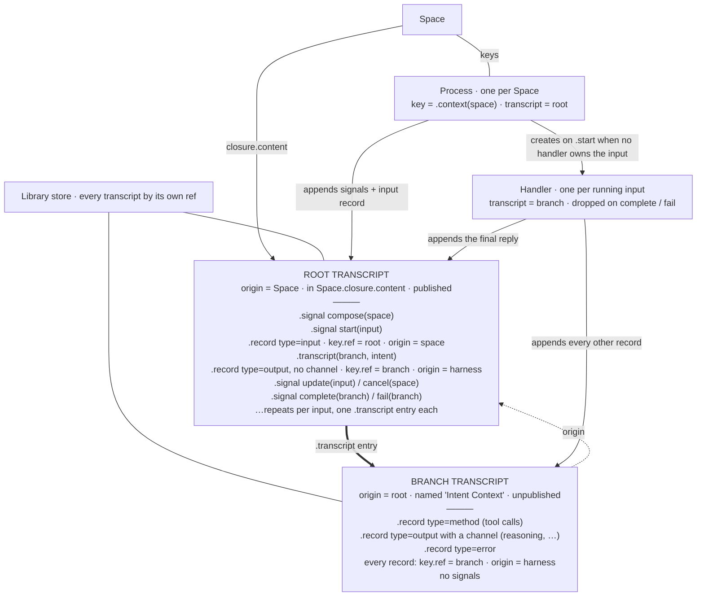
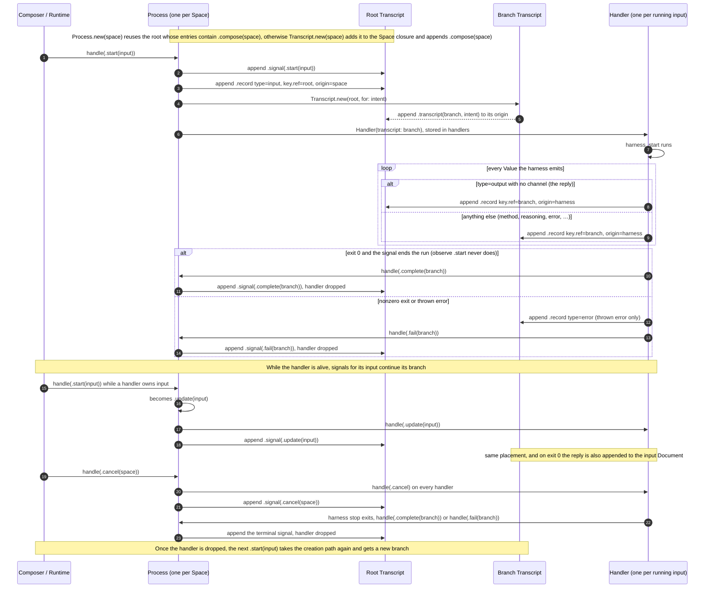

# Transcripts

A transcript is a `Material` with a `ref`, an `origin`, and an append-only list of entries:

```swift
public enum Entry {
    case record(Record, Date)
    case signal(UUID, Signal, Date)
    case transcript(Reference, Intent, Date)
}
```

`.record` and `.signal` are immutable, concrete data. `.transcript` is the only relational case: it references another transcript.

## Root and branch

- **Root**: `origin` is a Space. There is one per Space, and it is added to the Space's closure content. It outlives any `Process`: `Process.new` finds it again by its `.compose(space)` signal.
- **Branch**: `origin` is a Transcript. There is one per `Handler`. `Transcript.new(root, for: intent)` always creates a new one, unpublished, and appends `.transcript(branch, intent)` to the root. Its only caller is `Process.compose`, which runs on a `.start(input)` when no handler owns that input.

A handler lives from that `.start` until `.complete(branch)` or `.fail(branch)` drops it. While it is alive, another `.start(input)` becomes `.update(input)` and continues the same branch. After it is dropped, the next `.start(input)` creates a new branch, so one input document can have several branches over time. Dropping a handler leaves its branch and the root's `.transcript` entry in place.

Every transcript, root or branch, is stored in the Library store under its own ref and is read directly with `Transcript.with(ref)`.

## Structure



## Placement

| Entry | Written by | Stored in | `key.ref` | `origin` |
|---|---|---|---|---|
| `.signal(.compose(space))` | `Process.new`, when the Space has no root yet | root | | |
| `.signal(.start(input))`, `.signal(.update(input))` | `Process` | root | | |
| `.record`, `type=input` | `Process.compose` | root | root | space |
| `.transcript(branch, intent)` | `Transcript.new(root, for:)` | root | | |
| `.record`, `type=output` with no channel (the reply) | `Handler` | root | branch | harness |
| `.record`, anything else (method, reasoning, error, …) | `Handler` | branch | branch | harness |
| `.signal(.complete(branch))`, `.signal(.fail(branch))` | `Process`, called by `Handler` | root | | |
| `.signal(.cancel(space))` | `Process` | root | | |

`Record.key.ref` names the transcript that produced the record. The reply is stored in the root but produced by the branch. `Record.origin` is the speaker.

## Order of writes


