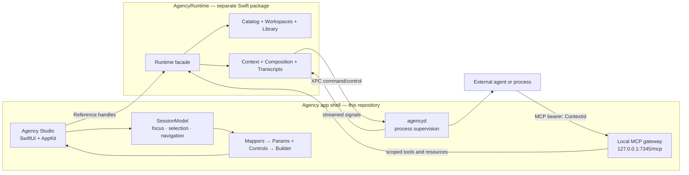

# Agency

Agency is a macOS-native workbench for building and running agent workflows as
explicit, inspectable systems. Instead of treating an agent as a chat window, it
models the context around a run—documents, tools, configuration, nested spaces,
execution history, and external resources—and keeps that context navigable in a
desktop interface.

This repository is the **application shell**. It owns Agency Studio, the local
MCP gateway, and the `agencyd` process service. The domain model and execution
semantics live in the separate **AgencyRuntime** Swift package, which this
project consumes as a local dependency from `../AgencyRuntime`
(`~/Developer/AgencyRuntime` in the current checkout).

Agency is an active systems prototype. The implemented path covers workspace
navigation, block-based sheet editing, runtime configuration, persistence,
composition, streamed transcripts, local process execution, URL callbacks, and
context-scoped MCP access.

## System boundary

| Component | Responsibility |
| --- | --- |
| **Agency Studio** | Presents and edits runtime state; manages windows, focus, selection, navigation, inspectors, and transcript views. |
| **Mappers and UI primitives** | Project domain references into reusable `Params` and `Controls`, then render them through a shared builder. |
| **Local MCP gateway** | Exposes the active context's published tools and resources to an executing agent over localhost. |
| **`agencyd`** | Runs and supervises local processes behind an XPC boundary, including streaming I/O and restart policies. |
| **AgencyRuntime** | Owns identity, typed stores, topology, metadata, persistence, search, intent composition, transcript state, and the XPC client. |



The boundary is intentional: the app is a consumer and visualizer of runtime
state, not a second implementation of it. UI code holds lightweight
`Reference` handles and resolves live values through AgencyRuntime's stores.
That preserves stable identity while avoiding long-lived, diverging copies of
domain objects in view state.

## Runtime model

AgencyRuntime combines typed, ECS-style stores with actor-like reference
handles. Its core vocabulary is small but composable:

| Concept | Role |
| --- | --- |
| `Workspace` / `Space` | A nested topology that defines the context visible at a point in the system. |
| `Closure` | The ordered content, interfaces, input, and configuration owned by a space. |
| `Sheet` | A block document containing text or references to other runtime values. |
| `Artifact` | A typed external resource such as a file, directory, URL, script, or executable. |
| `Command` / `Harness` | A typed capability and its intent-specific configuration. |
| `Context` / `Composition` | The request runner and the app-facing live read model for an active run. |
| `Transcript` / `Signal` | The append-only execution record from which lifecycle state is derived. |

Runtime values are grouped by behavior rather than by UI:

- **Structural** values describe topology: workspaces, spaces, closures, and
  routes.
- **Malleable** values are editable content: sheets and transcripts.
- **Functional** values expose capabilities: artifacts, commands, and
  harnesses.
- **Contextual** values represent requests and intents.

Metadata is held separately in a catalog, while workspace structure and library
content are persisted in dedicated stores. References carry enough identity to
locate the correct type, descriptor, context, and storage location. Reads happen
through scoped accessors; mutations go through store updates so persistence and
composition observers see one authoritative change stream.

## From interaction to execution

1. **Author context.** A user navigates a workspace, edits sheets, attaches
   artifacts and commands, and configures a harness for a space.
2. **Capture session state.** On composition, Studio serializes the relevant UI
   focus, selection, open documents, and navigation path into the runtime input.
   The application session becomes explicit context rather than hidden global
   state.
3. **Resolve an intent.** AgencyRuntime selects the configured harness, binds
   typed `Value` inputs and configuration to its command arguments, and creates
   a root transcript plus an intent branch.
4. **Cross the execution boundary.** The runtime sends the resolved command to
   `agencyd` over XPC. The daemon owns process lifecycle, environment expansion,
   stdin, combined stdout/stderr streaming, inspection, and restart behavior.
5. **Record, do not mirror.** Output is parsed into transcript signals and
   properties. `Composition` derives active, running, completed, or failed state
   from the live context and transcript tree instead of maintaining a parallel
   process-state cache.
6. **Expose scoped capabilities.** While a composition is active, the local MCP
   gateway publishes only the commands, harnesses, sheets, artifacts, and
   transcripts allowed by that context. The `ContextId` is the bearer token, and
   `AGENCY_CONTEXT` is passed to launched processes so they can call back into
   the same scope.

This flow makes provenance inspectable: configuration, inputs, tool access,
process output, and terminal state all remain connected to the context that
produced them.

## Application architecture

### Reference-driven session state

`AgencyModel` boots the runtime, restores or creates the Studio workspace,
starts the MCP server, and routes `agency://` callbacks. `StudioModel` then
coordinates the library, canvas, inspector, action panel, file provider, and a
`SessionModel`.

The session model stores references—not copied domain models—across independent
selection axes for structure, interfaces, content, entries, and paths. It also
maintains bounded navigation history and produces a serializable view of the
current session for composition.

### Data-driven presentation

The presentation layer separates domain queries from reusable rendering:

```text
AgencyRuntime references
        ↓
Mapper: resolve and shape live domain state
        ↓
Params: immutable presentation description
Controls: closures for permitted actions
        ↓
Builder / Surface: grid, group, list, table, editor, or transcript UI
```

This projection layer centralizes selection, focus, context menus, drag and
drop, clipboard behavior, and editing conventions. A new surface can reuse
those interactions without embedding runtime mutations throughout a SwiftUI
view tree.

### Native macOS integration

SwiftUI provides the scene and navigation structure, while AppKit is used where
desktop behavior needs tighter control:

- a TextKit-backed block editor with caret coordination, block transforms, and
  runtime search;
- `NSSplitView` bridges for collapsible, restorable panes;
- a floating `NSPanel` for global actions and keyboard-driven dismissal;
- pasteboard and drag payloads that preserve reference identity and prevent
  invalid topology cycles.

The transcript surface understands both generic streamed text and structured
Codex events, including messages, reasoning, command execution, and tool calls.

## Repository map

```text
Sources/
├── Agency/
│   ├── Agency.swift             App entry point and scenes
│   ├── AgencyModel.swift        Runtime bootstrap and app coordination
│   ├── Studio/                  Library, canvas, inspector, and transcript UI
│   ├── Mappers/                 Domain-to-presentation projections
│   ├── Core/                    Builder, Params, Controls, and shared types
│   ├── Server/                  MCP protocol adapter and localhost transport
│   ├── Models/                  Session, actions, navigation, and panels
│   └── Providers/               Runtime action and filesystem adapters
├── Editor/                      Sheet-editing subsystem used by Studio
└── Service/                     agencyd XPC service and process supervisor

Resources/
├── Info.plist                   URL scheme and document type declarations
├── *.entitlements               Shared app-group configuration
└── serviceRegistration.sh       Development LaunchAgent registration

../AgencyRuntime/                Separate runtime package and its test suite
```

## Build and run

The project currently targets Swift 6 with Xcode 27 and the macOS 27 SDK. The
Agency app deploys to macOS 27.0; `agencyd` currently deploys to macOS 26.2.

1. Check out `Agency` and `AgencyRuntime` as sibling directories. The Xcode
   project resolves AgencyRuntime from `../AgencyRuntime`.
2. Open `Agency.xcodeproj`.
3. Select the **Agency** scheme and run it on **My Mac**. Swift Package Manager
   resolves the remaining dependencies, including the Swift MCP SDK and
   KeyboardShortcuts.

The development build runs `Resources/serviceRegistration.sh`. It writes
`~/Library/LaunchAgents/com.kaechle.agencyd.plist` and reloads the service with
`launchctl`, pointing it at the newly built `agencyd.xpc` executable. This is a
development-time installation step and changes the current user's LaunchAgent
configuration.

On an empty data store, first launch creates sample workspace content and
interfaces. Some samples assume Codex is installed at
`/opt/homebrew/bin/codex`; the OpenAI Responses sample reads `OPENAI_API_KEY`.

Runtime data follows the XDG data convention:

```text
$XDG_DATA_HOME/agency
```

and falls back to:

```text
~/.local/share/agency
```

Workspaces are persisted as topology graphs, while library objects are stored
individually as JSON. Writes are atomic, batched, and debounced by the runtime.

## Trust model and current status

Agency is designed for local, user-controlled automation. The MCP server binds
only to localhost and requires a live context token; tool/resource visibility
is further constrained by publication state and the active closure. Process
execution is isolated behind XPC for lifecycle and I/O ownership.

It is not yet a hardened distribution boundary. The app and daemon currently
run without App Sandbox or Hardened Runtime, and imported executable harnesses
can launch local processes with the user's authority. Treat workspaces,
commands, and artifacts as trusted input.

The core authoring-to-execution path is implemented, but the project remains in
active development: several action entry points and toolbar affordances are
placeholders, traversal intent behavior is still minimal in AgencyRuntime, and
the application does not yet have a dedicated test target. Runtime-level tests
live in the sibling package.
