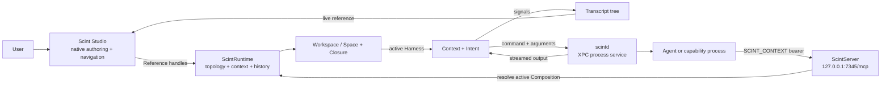

# Scint

Scint is a native Mac application for composing agentic work as an inspectable, repeatable, contextual processes and systems . It brings documents, files, tools, configuration, execution, and history into one spatial model that's runnable from a place with durable context—not from a prompt assembled just before you interact with the agent.

Most agent interfaces begin with a chat and make the user repeatedly reconstruct the world around it. Scint begins with a workspace. Inside it, nested `Space`s hold scenes, resources, capabilities, configuration, and prior runs. Give a space an active `Harness`, and that authored environment can become a live process without ceasing to
be the place the user navigates and edits.

> In Scint, an agent doesn't merely receive context. It's an agentic process executed from a place that already
> has context.

This is what Scint calls **topological agentic process composition**: author the shape
of a working environment, attach behavior at the appropriate boundary, and let the
runtime evaluate work in the context of that topology.

## What that phrase means

| Term | Meaning in Scint |
| --- | --- |
| **Topological** | Context is organized as workspaces with nested spaces, local closures, and bridges between adjacent environments. Position, ownership, and reachability determine what belongs to a process. |
| **Agentic** | Commands supply executable capabilities; a harness binds a command to contextual parameters and an intent: compose, dispatch, observe, execute, or traverse. |
| **Process composition** | The runtime maps an authored space and its active harness into a live context, evaluates ephemeral intents, and records their durable transcript history. |

The topology is not decorative organization around an otherwise global agent. A
space's closure determines its information, interfaces, input, and configuration. Its
active harness determines the work it can start. Its transcript tree preserves the
relationship between environment, input, activity, and outcome.

Scint Studio then maps those same runtime references into live native views. The app
does not keep a parallel copy of the world for the UI; sidebars, canvases, inspectors,
editors, palettes, and transcripts continually resolve the runtime values they present.

## Working in Scint

A typical flow looks like this:

1. **Choose a place.** Navigate a workspace or nested space representing a project,
   client, investigation, recurring operation, or another meaningful boundary.
2. **Author the environment.** Build `Scene`s from text, tasks, and references to other
   scenes, files, and commands. Attach directories, documents, URLs, scripts, skills,
   or executables as `Artifact`s.
3. **Add capabilities.** Make commands and harnesses available in the space, choose the
   active harness, and configure its typed arguments in the inspector.
4. **Supply the immediate objective.** Write into the composer input. Scint also makes
   the relevant application session—focus, selection, and open material—explicit input
   to the run.
5. **Run in place.** Start with the composer button or Command–Return. The runtime turns
   the selected space into a live context and evaluates the harness through the local
   process service.
6. **Follow the record.** Output streams into an intent transcript beneath the space's
   root transcript. Messages, reasoning, tool activity, failures, and terminal outcomes
   remain connected to the context that produced them.
7. **Continue from the same topology.** Edit the scenes, change capabilities, move into
   a narrower space, or return to an earlier transcript without rebuilding the world in
   another chat window.

The Studio experience is deliberately Mac-native:

- a workspace sidebar for nested spaces, open scenes, transcripts, library interfaces,
  and attached filesystem locations;
- a visual canvas for the contents of the selected workspace or space;
- a block editor for authoring scenes and embedding runtime references;
- a composer for input and streamed transcript output;
- an inspector for harnesses, commands, files, and execution configuration;
- a keyboard-driven floating palette for searching content, interfaces, and topology;
- native context menus, inspectors, split views, keyboard shortcuts, and drag and drop;
  and
- a menu-bar surface for the local MCP server.

## One model, several projections

Scint is a monorepo with four source areas that share the same reference-addressed
domain model:

| Layer | Responsibility |
| --- | --- |
| **Scint** | The SwiftUI/AppKit application, session model, mapping framework, editor, Studio, inspector, and palette |
| **ScintRuntime** | References, typed stores, authored topology, persistence, search, contexts, intents, compositions, and transcripts |
| **ScintServer** | A loopback MCP projection of the tools and resources belonging to a currently active context |
| **ScintService** | The `scintd` XPC service that launches and supervises executable processes and streams their output |



Two forms of composition meet at the application boundary:

- **Runtime composition** maps a structural origin and its live context into a
  `Composition` without duplicating process state.
- **View composition** maps references and session state through `Mapper` into
  presentation `Params`, behavioral `Controls`, and native surfaces without duplicating
  domain state.

The result is a UI that behaves like a live lens over the runtime. Selecting a
reference changes what is resolved. Editing bridges mutations back to the typed store.
Starting a space yields a transcript reference that the same UI framework already knows
how to open and render.

## From input to transcript

When a run starts, the layers contribute in sequence:

1. Scint adds the current session description to the selected origin's authored input.
2. `Composer` creates or reuses the origin's live `Context`.
3. The context creates an `Intent` and a child transcript beneath its root history.
4. `Parser` binds closure configuration and rendered scene input to typed harness and
   command parameters.
5. `Harness → Command → Artifact` resolves the executable invocation.
6. `scintd` owns the process identifier, standard input and output, termination, and
   restart behavior behind XPC.
7. Streamed output becomes `Signal`s written into the intent transcript.
8. The app resolves that transcript and the current `Composition` to present the livesult.

The intent disappears when it reaches a terminal signal. The transcript does not. The
runtime can therefore remain lightweight in memory while the process retains a durable,
inspectable wake.

## Contextualized Model Context Protocol

Scint includes a local MCP server at `http://127.0.0.1:7345/mcp`. A process launched for
an active space receives its contextual identity in `SCINT_CONTEXT`; configured agent
clients can present that value as the bearer for MCP requests.

On each request, ScintServer resolves the current live composition and derives the
published commands, harnesses, and resources from that origin's closure. The server
does not maintain a parallel capability grant or context snapshot. When the composition
is no longer active or running, its MCP surface is no longer available.

This lets a process reach back into the same authored environment without
turning every runtime value into global tooling.

## Repository map

```text
Sources/
├── Scint/                       App, framework, Studio, palette, editor
├── ScintRuntime/                Context model, stores, topology, execution
├── ScintServer/                 Loopback MCP server and context projection
└── ScintService/                scintd XPC service and process supervision

Docs/
├── Scint.md                     Application and live-view architecture
└── ScintRuntime.md              Runtime process and context model

Resources/
├── Assets.xcassets/             App assets
├── Info.plist                   URL and transferable type declarations
├── Scint.entitlements           Shared app-group entitlement
├── Service.plist                Development LaunchAgent definition
└── serviceRegistration.sh       Development service registration
```

For the deeper designs, read:

- [Scint application and framework architecture](Docs/Scint.md)
- [ScintRuntime process and context model](Docs/ScintRuntime.md)

## Build and run

The current Xcode targets use Swift 6 and deploy to macOS 27.0.

1. Open `Scint.xcodeproj`.
2. Select the **Scint** scheme.
3. Run on **My Mac**.

Swift Package Manager resolves Swift Collections, KeyboardShortcuts, and the Swift MCP
SDK. On an empty store, first launch creates a sample Scint workspace with scenes,
spaces, artifacts, commands, and harnesses.

The development build phase invokes `Resources/serviceRegistration.sh`, which is
intended to install and reload `com.kaechle.scintd` as a per-user LaunchAgent for the
built XPC service. This changes the current user's LaunchAgent configuration.

Some sample capabilities expect:

- Codex CLI at `/opt/homebrew/bin/codex`; and
- `OPENAI_API_KEY` for the OpenAI Responses example.

Runtime data follows the XDG data convention:

```text
$XDG_DATA_HOME/Scint
```

and falls back to:

```text
~/.local/share/Scint
```

Structural values are persisted together as a workspace graph. Scenes, transcripts,
artifacts, commands, and harnesses are stored as individual library records. Writes are
atomic and coordinated through debounced runtime saves.

## Status and trust

The app and service currently run without App Sandbox or Hardened Runtime. Executable
artifacts and harnesses run with the user's authority. Treat workspaces, imported
capabilities, and executable configuration as trusted input. The MCP server binds only
to loopback and requires a live context identifier, but that does not make untrusted
commands safe to execute.
